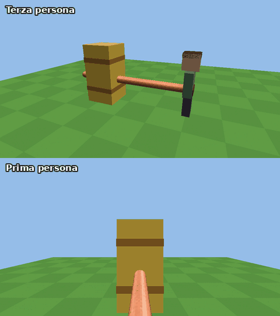
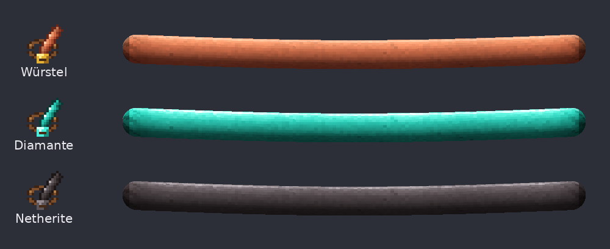

# Würstel Gigante (Forge 1.20.1)

Una cintura che porta un würstel gigante: 4 blocchi di lunghezza, ¼ di blocco di spessore, appeso sul davanti e sempre puntato dove guardi. Indossandola, i pugni a mano vuota diventano schiaffi di würstel morbidi e snodabili, ogni volta da un'angolazione diversa (destra, sinistra, dall'alto, dal basso, in diagonale), contro mob, giocatori e blocchi.



## Installazione

1. Installa **Minecraft Forge 1.20.1** (versione 47.x).
2. Scarica `wurstel-1.1.0.jar` dalla pagina [Releases](../../releases).
3. Mettilo nella cartella `mods` di Minecraft (anche sul server, in multiplayer).

## Come si usa

- **Würstel**: `bistecca di maiale cotta` + `filo` → 2 würstel (si possono anche mangiare).
- **Cintura Würstel**:
  ```
  cuoio   lingotto d'oro   cuoio
  würstel     würstel      würstel
  ```
- Indossa la cintura nello slot dei **pantaloni** (o tasto destro tenendola in mano).
- A mano vuota, dai pugni come al solito: invece del braccio parte lo schiaffo col würstel. Funziona su mob, giocatori (con PvP attivo) e per rompere i blocchi. Gli schiaffi colpiscono sempre a piena forza, anche se clicchi in fretta.
- La trovi anche in Creativa, nelle schede *Combattimento* e *Cibo e bevande*.

Il würstel si vede in terza persona, lo vedono gli altri giocatori e lo vedi anche in prima persona. Ondeggia mentre cammini e salti, e segue la testa con un po' di ritardo.

## Würstel di diamante e di netherite



- **Cintura Würstel di Diamante**, al banco da lavoro:
  ```
              diamante
  diamante    cintura     diamante
              diamante
  ```
- **Cintura Würstel di Netherite**, al tavolo da forgia: `modello di forgiatura` (potenziamento in netherite) + `cintura di diamante` + `lingotto di netherite`, come per le armature.

Gli incantesimi e il nome restano quando potenzi la cintura. Il würstel cambia colore (anche addosso al giocatore) e brilla se la cintura è incantata.

| Cintura | Danno degli schiaffi | Velocità di scavo | Blocchi che lasciano il drop | Armatura |
|---|---|---|---|---|
| Würstel | ×2 | ×1 | come la mano | 1 |
| Diamante | ×4 | ×8 | come un attrezzo di diamante (pietra, minerali, ossidiana...) | 2 |
| Netherite | ×8 | ×9 | come un attrezzo di netherite; non brucia nella lava | 3 |

Il danno è rispetto a un pugno; la velocità di scavo rispetto alla mano (8 e 9 sono le velocità del piccone di diamante e di netherite).

## Incantesimo Turgido (I–V)

- Va sulle cinture würstel: ogni livello **raddoppia** il danno degli schiaffi (I ×2, II ×4, III ×8, IV ×16, V ×32).
- Lo trovi sui libri incantati (tavolo per incantesimi, bibliotecari, bauli) e lo metti sulla cintura con l'incudine. Le cinture ora si possono anche incantare direttamente al tavolo per incantesimi.
- Due libri Turgido IV nell'incudine fanno un Turgido V.
- In Creativa i libri Turgido I–V sono nella scheda *Combattimento*.
- **Cintura di netherite + Turgido V** = schiaffi ×256: un solo schiaffo uccide l'**Ender Dragon**.

Nel suggerimento della cintura vedi il moltiplicatore di danno totale (con Turgido) e quello di scavo.

## Configurazione

- `config/wurstel-client.toml`: `showInFirstPerson`, `sounds`, `particles`.
- `saves/<mondo>/serverconfig/wurstel-server.toml`:
  - `[slap]`: `damageMultiplier` (default 2, il doppio di un pugno), `extraKnockback` (default 0.6), `miningSpeedMultiplier` (default 1) della cintura normale;
  - `[diamond]` e `[netherite]`: `damageMultiplier` (4 e 8) e `miningSpeedMultiplier` (8 e 9);
  - `[turgido]`: `damageMultiplierPerLevel` (default 2: ogni livello raddoppia il danno).

## Compilare da soli

Serve Java 17 o più recente:

```
./gradlew build
```

Il jar finisce in `build/libs/`. Su GitHub la compilazione parte da sola a ogni push (GitHub Actions): ogni versione nuova di una mod viene pubblicata in una Release sua, senza toccare quelle vecchie.

## Altre mod

Questo repository può contenere più mod: il Würstel Gigante sta nella radice, ogni altra mod in una cartella `mods/<nome>/` con il suo jar e le sue Release.
