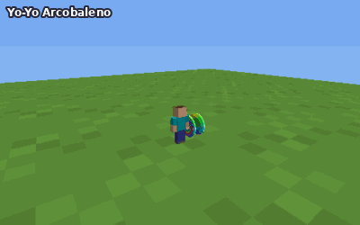
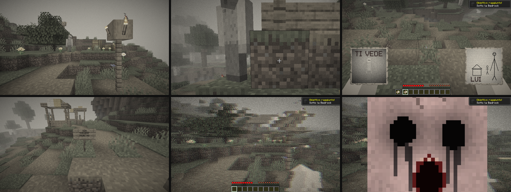
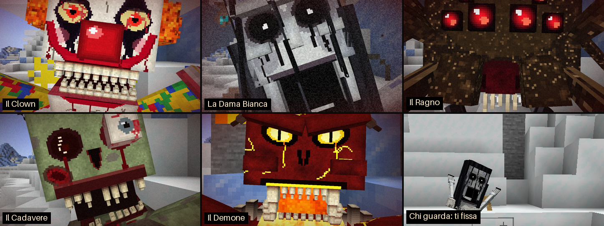
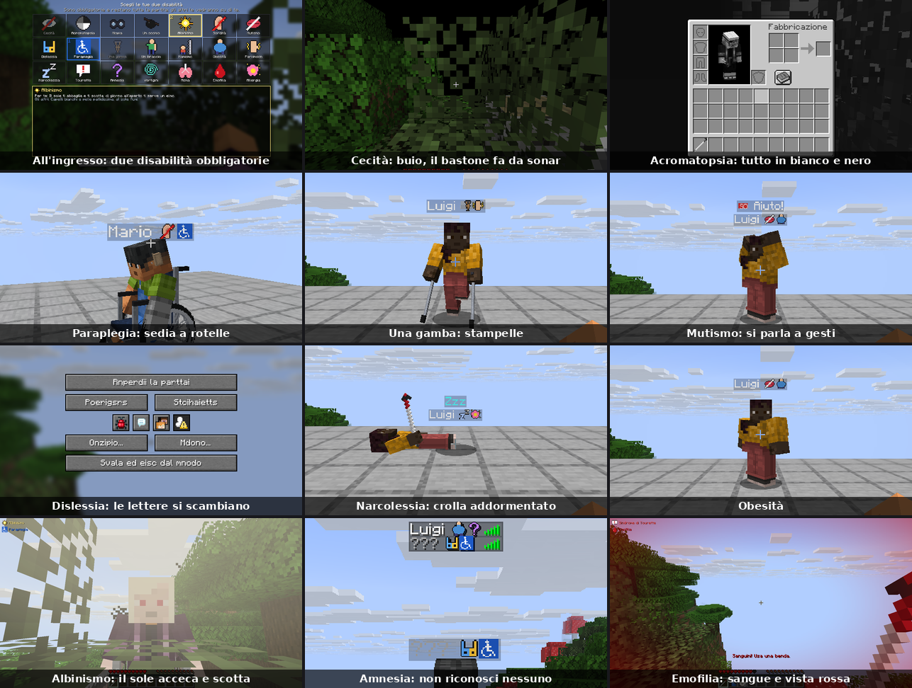
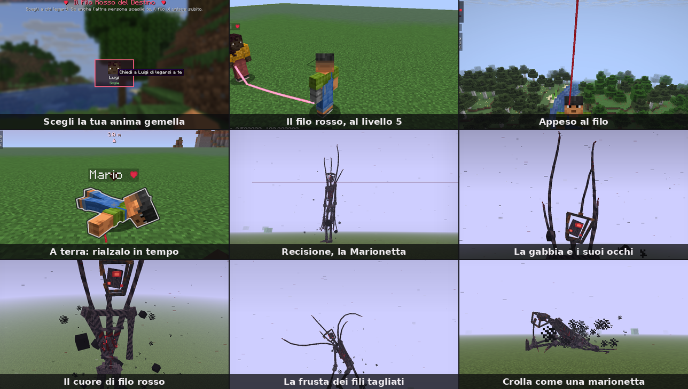
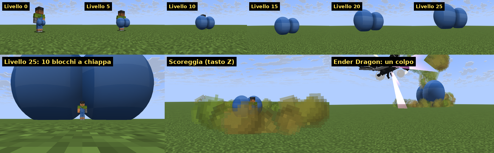
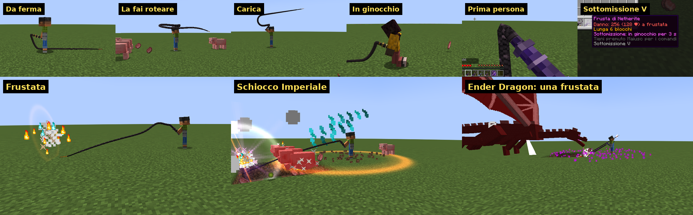

# Würstel Gigante (Forge 1.20.1)

Una cintura che porta un würstel gigante: 4 blocchi di lunghezza, ¼ di blocco di spessore, appeso sul davanti e sempre puntato dove guardi. Indossandola, i pugni a mano vuota diventano schiaffi di würstel morbidi e snodabili, ogni volta da un'angolazione diversa (destra, sinistra, dall'alto, dal basso, in diagonale), contro mob, giocatori e blocchi.


## Installazione

1. Installa **Minecraft Forge 1.20.1** (versione 47.x).
2. Scarica `wurstel-1.1.0.jar` dalla pagina [Releases](../../releases).
3. Mettilo nella cartella `mods` di Minecraft (anche sul server, in multiplayer).

## Come si usa

- **Würstel**: `bistecca di maiale cotta` + `filo` → 2 würstel (si possono anche mangiare).
- **Cintura Würstel**:
  ```
  cuoio   lingotto d'oro   cuoio
  würstel     würstel      würstel
  ```
- Indossa la cintura nello slot dei **pantaloni** (o tasto destro tenendola in mano).
- A mano vuota, dai pugni come al solito: invece del braccio parte lo schiaffo col würstel. Funziona su mob, giocatori (con PvP attivo) e per rompere i blocchi. Gli schiaffi colpiscono sempre a piena forza, anche se clicchi in fretta.
- La trovi anche in Creativa, nelle schede *Combattimento* e *Cibo e bevande*.

Il würstel si vede in terza persona, lo vedono gli altri giocatori e lo vedi anche in prima persona. Ondeggia mentre cammini e salti, e segue la testa con un po' di ritardo.

## Würstel di diamante e di netherite


- **Cintura Würstel di Diamante**, al banco da lavoro:
  ```
              diamante
  diamante    cintura     diamante
              diamante
  ```
- **Cintura Würstel di Netherite**, al tavolo da forgia: `modello di forgiatura` (potenziamento in netherite) + `cintura di diamante` + `lingotto di netherite`, come per le armature.

Gli incantesimi e il nome restano quando potenzi la cintura. Il würstel cambia colore (anche addosso al giocatore) e brilla se la cintura è incantata.

| Cintura | Danno degli schiaffi | Velocità di scavo | Blocchi che lasciano il drop | Armatura |
|---|---|---|---|---|
| Würstel | ×2 | ×1 | come la mano | 1 |
| Diamante | ×4 | ×8 | come un attrezzo di diamante (pietra, minerali, ossidiana...) | 2 |
| Netherite | ×8 | ×9 | come un attrezzo di netherite; non brucia nella lava | 3 |

Il danno è rispetto a un pugno; la velocità di scavo rispetto alla mano (8 e 9 sono le velocità del piccone di diamante e di netherite).

## Incantesimo Turgido (I–V)

- Va sulle cinture würstel: ogni livello **raddoppia** il danno degli schiaffi (I ×2, II ×4, III ×8, IV ×16, V ×32).
- Lo trovi sui libri incantati (tavolo per incantesimi, bibliotecari, bauli) e lo metti sulla cintura con l'incudine. Le cinture ora si possono anche incantare direttamente al tavolo per incantesimi.
- Due libri Turgido IV nell'incudine fanno un Turgido V.
- In Creativa i libri Turgido I–V sono nella scheda *Combattimento*.
- **Cintura di netherite + Turgido V** = schiaffi ×256: un solo schiaffo uccide l'**Ender Dragon**.

Nel suggerimento della cintura vedi il moltiplicatore di danno totale (con Turgido) e quello di scavo.

## Configurazione

- `config/wurstel-client.toml`: `showInFirstPerson`, `sounds`, `particles`.
- `saves/<mondo>/serverconfig/wurstel-server.toml`:
  - `[slap]`: `damageMultiplier` (default 2, il doppio di un pugno), `extraKnockback` (default 0.6), `miningSpeedMultiplier` (default 1) della cintura normale;
  - `[diamond]` e `[netherite]`: `damageMultiplier` (4 e 8) e `miningSpeedMultiplier` (8 e 9);
  - `[turgido]`: `damageMultiplierPerLevel` (default 2: ogni livello raddoppia il danno).

## Compilare da soli

Serve Java 17 o più recente (Java 21 per le mod Fabric 1.21.1):

```
./gradlew build
```

Il jar finisce in `build/libs/`. Su GitHub la compilazione parte da sola a ogni push (GitHub Actions): ogni versione nuova di una mod viene pubblicata in una Release sua, senza toccare quelle vecchie.

## Altre mod

Questo repository può contenere più mod: il Würstel Gigante sta nella radice, ogni altra mod in una cartella `mods/<nome>/` con il suo jar e le sue Release.

### Yo-Yo Arcobaleno (`mods/rainbow-yoyo/`)



Uno yo-yo arcobaleno gigante (1,25 blocchi), per Forge 1.20.1. Jar: `rainbowyoyo-1.0.0.jar` nelle [Releases](../../releases). Va installato anche sul server, in multiplayer.

- **Ricetta** (banco da lavoro):
  ```
  lana rossa   lana arancione       lana gialla
  filo         blocco di diamante   filo
  lana lime    lana azzurra         lana viola
  ```
- **Tasto destro (tieni premuto)**: lo lanci e gira in fondo al filo (8 blocchi), seguendo il mirino. Rilascia e torna in mano. Non ti rallenta.
- **Tasto sinistro**: colpo rapido dritto davanti a te.
- **Tasto sinistro con lo yo-yo fuori**: un trick.
  - guardando avanti: **Loop the Loop**, tre giri della morte giganti davanti a te;
  - guardando in alto: **Shoot the Moon**, sale di 10 blocchi e si schianta a terra con un'onda d'urto;
  - guardando in basso: **Walk the Dog**, rotola per terra come una ruota per 9 blocchi e torna;
  - accovacciato: **Around the World**, due giri orizzontali intorno a te, come una sega circolare.
- I quattro trick in una sola combo caricano la **Supernova Arcobaleno**: il clic successivo fa crescere lo yo-yo, che esplode in fuochi d'artificio colpendo tutto nel raggio di 7 blocchi.
- **Ogni colpo fa 40 cuori di danno** (80 punti), con messaggi di morte suoi.
- Scia luminosa arcobaleno, bordo che brilla al buio, particelle, suoni sintetizzati (lancio, ronzio che sale con la velocità, colpi, trick, schianto, Supernova). Il braccio segue il filo anche in prima persona.
- Config: `saves/<mondo>/serverconfig/rainbowyoyo-server.toml` (`damage`, `stringLength`) e `config/rainbowyoyo-client.toml` (`trail`, `particles`).

### Sotto la Bedrock (`mods/below-bedrock/`)



Una mod misteriosa per **Fabric 1.21.1**: serve anche **Fabric API**. Jar: `belowbedrock-1.1.0.jar` nelle [Releases](../../releases). Va installata anche sul server, in multiplayer.

- **Piccone di diamante glitchato**: la ricetta del piccone di diamante, ma al contrario. La texture ogni tanto si glitcha e una lettera del nome non si legge mai.
  ```
              bastone
              bastone
  diamante    diamante    diamante
  ```
- È l'unico attrezzo che **rompe la bedrock** (circa 4 secondi a blocco), solo nel mondo normale e in quello sbiadito.
- **Buttati nel vuoto**: non muori. Cadi per 30-40 secondi nel buio, con il vento, un disco suonato troppo lento, un battito che accelera, voci e glitch. Poi diventa tutto nero...
- ...e ti svegli nel **mondo sbiadito**: è la mappa del tuo mondo (stesso seme, infinita come quella normale), ma senza colori, senza sole, senza animali né mostri, sempre di giorno, nella nebbia. E non ci cresce niente: niente alberi, niente erba, niente fiori, funghi o alghe; il terreno è terra nuda e nei villaggi i campi sono vuoti. E la tua casa non c'è.
- In giro trovi dettagli inquietanti: cartelli che sanno troppo, pezzi di muro in mezzo al nulla, tunnel 2x2, piramidi di sabbia nel mare, porte che non portano da nessuna parte, letti all'aperto, fuochi eterni, accampamenti abbandonati, bauli sepolti sotto un cartello "QUI", stanze vuote (gialle, bianche o camere da letto), pozzi dritti fino alla bedrock, figure ferme nella nebbia. E le **mappe**: 9 immagini di Lui, appese ai muri e nelle stanze o chiuse nei bauli, insieme al diario di chi è caduto prima di te.
- **Lui**: alto, pallido, occhi neri, braccia troppo lunghe, nessuna ombra. Non si può ferire.
  - ti guarda da lontano e sparisce se lo fissi;
  - compare con la coda dell'occhio;
  - si avvicina solo quando non lo guardi: quando è dietro di te, girati...;
  - ti imita come in uno specchio;
  - ti lascia dei regali (mappe, il diario, un libro con il tuo nome);
  - a volte ti insegue, e guardarlo non lo ferma.
- **Cose strane**, sempre più spesso più a lungo resti: passi dietro di te, porte che si aprono, torce che si spengono, versi di animali che qui non esistono, sussurri in chat ("Lui ti sussurra: ..."), "*il tuo nome* ha lasciato la partita", un jukebox che suona *11* nella nebbia, cartelli con il tuo nome, finti lag, blocchi sbagliati, la nebbia che si chiude, lo schermo che si strappa, la sua faccia per un istante.
- Qui non si dorme: i letti dicono che ci sono mostri vicino. Bussola e orologio impazziscono.
- **Uscire**: muori (torni al tuo letto), oppure scava fino alla bedrock del mondo sbiadito e buttati di nuovo. Una volta a casa, però, ogni tanto lo rivedi in lontananza.
- Progressi nascosti nella scheda *Minecraft*.
- Multiplayer: ognuno vive la sua storia, ma Lui lo vedono tutti.
- Per i video (da operatore):
  - `/faded him <watch|peek|stalk|mimic|gift|chase>`: fa apparire Lui adesso, in quella modalità;
  - `/faded event <nome>`: fa succedere subito una cosa strana (i nomi li suggerisce il tab, es. `footsteps`, `whisper`, `jukebox`, `fog`, `name_sign`);
  - `/faded fall`: ti butta subito nel vuoto, senza scavare;
  - l'uovo generatore (scheda *Uova generatrici*) o `/summon belowbedrock:inhabitant`: Lui resta fermo a fissarti.
- Gamerule: `/gamerule fadedHauntings false` (niente eventi e niente Lui), `/gamerule fadedSightings false` (non ti segue più a casa).

### Jumpscare! (`mods/jumpscares/`)



Jumpscare da fare agli amici, per **Fabric 1.21.1**: serve anche **Fabric API**. Jar: `jumpscares-1.0.0.jar` nelle [Releases](../../releases). Va installata sul server e da tutti i giocatori (chi non ce l'ha non vede niente).

- **Cinque mostri 3D** che ti saltano in faccia, ognuno con entrata, urla ed effetti suoi:
  - **Il Clown**: salta fuori dal basso su una molla, come un pupazzo a molla, ride e poi ti urla in faccia con due file di denti a punta. Flash rosso e coriandoli.
  - **La Dama Bianca**: si avvicina a scatti tra le scariche di disturbo, con la testa piegata; poi la mascella le scivola giù e si apre un buco nero. Strillo da banshee, e dopo qualche secondo di Oscurità.
  - **Il Ragno**: cala dall'alto sul suo filo, occhi lucidi, zanne che colano veleno, zampe che ti avvolgono. Sibilo, ragnatele e Lentezza (resti paralizzato).
  - **Il Cadavere**: arriva a scatti come un pupazzo rotto, con un occhio fuori dall'orbita e la testa che si contorce. Ruggito marcio e Nausea.
  - **Il Demone**: sale dal basso tra le fiamme, corna, crepe di lava e la gola come una fornace. Ruggito profondo con un boato.
- Ogni jumpscare: il mostro arriva a pochi centimetri dalla telecamera, lo schermo trema, flash colorato, disturbo e vignetta; poi l'ultimo balzo dentro la sua bocca e tutto nero. L'HUD sparisce (e gli effetti si vedono anche con F1). Chi lo subisce fa un piccolo salto indietro.
- **Suoni fortissimi**: urla sintetizzate (suonate due volte insieme) e un colpo d'orchestra. Occhio alle cuffie.
- **Perle Spavento**, una per mostro: si lanciano come le perle di ender. Chi viene colpito, o è a meno di 2,5 blocchi da dove cade, si prende quel jumpscare; chi l'ha lanciata legge "Hai spaventato ...!". Lanciata ai tuoi piedi spaventa te, così la provi anche da solo. Funzionano anche nel distributore: una trappola dietro una piastra a pressione.
- **Ricette** (senza forma, danno 2 perle):
  - Clown: perla di ender + colorante rosso + colorante bianco
  - Dama Bianca: perla di ender + membrana di fantasma + colorante nero
  - Ragno: perla di ender + occhio di ragno + filo
  - Cadavere: perla di ender + carne marcia + osso
  - Demone: perla di ender + polvere di blaze + carica di fuoco
- **Comando** (da operatore, o con i trucchi attivi): `/jumpscare <giocatori> [clown|dama|ragno|cadavere|demone|casuale] [secondi]`. Con i secondi parte più tardi, così hai il tempo di fare l'indifferente. Il messaggio di conferma lo vedi solo tu.
- **Multiplayer**: chi è vicino vede il mostro saltare in faccia alla vittima, lo sente urlare... e a un certo punto il mostro gira la testa e fissa anche lui.
- Accessibilità: *Effetti di distorsione* attenua il tremolio, *Lampi nel cielo attenuati* attenua i flash.

### Disabilità (`mods/disabilities/`)



Per **Fabric 26.3** (l'ultima versione di Minecraft): serve **Fabric API 0.163.0+26.3** e **Java 25**. Jar: `disabilities-1.0.1.jar` nelle [Releases](../../releases) (la 1.0.0 non faceva cliccare le carte nella scelta: usate la 1.0.1). Va installata sul server **e da tutti i giocatori**: chi entra senza la mod viene rimandato indietro con un messaggio.

- **Alla prima entrata nel mondo è obbligatorio scegliere due disabilità** su 21, da una schermata che non si può chiudere (finché scegli non puoi essere ferito). Passando sopra una carta leggi cosa cambia per te e cosa vedono gli altri. Il pulsante *Casuale* sceglie per te.
- **Ognuno le sue**: due giocatori non possono avere la stessa disabilità (con 8 giocatori se ne usano 16 su 21). Le carte già prese sono segnate *PRESA*; alcune coppie non vanno insieme (cieco + miope, sedia a rotelle + stampelle, stampelle + un braccio solo...).
- Quando qualcuno sceglie, in chat compare per tutti: "*Mario ha scelto: ♿ Paraplegia e 🔇 Sordità*" (passa sopra i nomi per la descrizione).
- **Le icone delle disabilità** stanno dopo il nome di ognuno: sopra la testa, nella lista giocatori (Tab), in chat e nei messaggi di morte. Le tue sono anche in alto a sinistra.
- Gli effetti sulla vista restano anche nascondendo l'HUD (F1) e in terza persona: niente trucchi.

| Disabilità | Cosa cambia per te | Cosa vedono gli altri |
|---|---|---|
| Cecità | Vedi solo a 3 blocchi, cielo compreso; chi fa rumore si illumina per un attimo. Col **bastone bianco** (tasto destro) per qualche secondo vedi intorno | Occhiali scuri, il bastone che batte a terra mentre cammini |
| Acromatopsia | Tutto in bianco e nero, inventario compreso | Occhiali con le lenti rosa |
| Miopia grave | Oltre pochi blocchi è tutto sfocato | Occhiali spessi |
| Cieco da un occhio | Metà sinistra dello schermo buia | Benda sull'occhio |
| Albinismo | Di giorno all'aperto il sole ti abbaglia e, senza elmo, ti brucia | Capelli bianchi e pelle pallidissima (dalla tua skin); fumi al sole |
| Sordità | Nessun suono, neanche la musica | Apparecchi acustici |
| Mutismo | Non puoi scrivere in chat (né /msg, /me...): fai i **gesti** col tasto **G** (Ciao, Sì, No, Vieni qui, Aiuto, Pericolo, Grazie, Seguimi) | Il gesto con le braccia, un fumetto sopra la testa e una riga in chat per chi è vicino |
| Dislessia | Tutte le scritte hanno le lettere che si mescolano (menu, chat, cartelli, inventario) | I tuoi messaggi in chat arrivano con le lettere scambiate |
| Paraplegia | Sedia a rotelle: niente salti, niente scale a pioli, liane o impalcature; più basso. La vedi anche in prima persona | Seduto sulla sedia, le ruote girano mentre ti muovi |
| Gamba amputata | Stampelle: più lento, niente corsa, salti bassi; **per usare le mani devi fermarti** | Una gamba sola e le stampelle che dondolano |
| Braccio amputato | Niente mano secondaria; archi, balestre, tridenti e lance non si usano; scavi più piano | Un braccio solo |
| Nanismo | Alto la metà, braccia corte (arrivi meno lontano), più lento | Sei piccolissimo |
| Obesità | Più lento, fame doppia, dopo 4 secondi di corsa hai il fiatone, le cadute fanno più male; però ti spostano meno | Corporatura enorme, fiatone e sudore |
| Parkinson | La mira trema sempre; ogni tanto le gambe si bloccano e ti scivola di mano quello che tieni | Testa e braccia che tremano |
| Narcolessia | Ogni 3-6 minuti ti addormenti di colpo per qualche secondo (schermo nero), a volte anche quando vieni colpito. Un amico ti sveglia col tasto destro | Crolli a terra, russi, "Zzz" sopra la testa |
| Sindrome di Tourette | Tic: scatti della testa, salti, colpi nel vuoto (a volte colpisci davvero chi hai davanti), giravolte, ammiccamenti, versi e parole a caso | Vedono i tic, sentono i versi, leggono le parole in chat e nel fumetto ("PATATA!") |
| Amnesia | Niente F3 (coordinate), niente libro delle ricette e niente segnalini dei compagni; i nomi degli altri diventano "???"; ogni 5-9 minuti l'inventario si rimescola | Ti gratti la testa sotto un "?" |
| Vertigini | Il mondo ondeggia, vicino ai burroni gira tutto (e lo zoom impazzisce), cammini storto e ogni tanto inciampi | Barcolli e inciampi |
| Asma | Correre, saltare, nuotare e arrampicarti ti tolgono il fiato (le bollicine dell'aria); senza fiato vedi buio ai lati e rallenti. Hai un **inalatore** | Il respiro che fischia, la mano sul petto |
| Emofilia | Ogni ferita continua a sanguinare (e intanto non guarisci) finché non usi una **benda** | Gocce di sangue, la mano sulla ferita; puoi fasciarli tu (tasto destro con la benda) |
| Allergia | Vicino a fiori, erba, foglie e animali starnutisci: la testa scatta, gli occhi lacrimano e a volte ti cade quello che tieni | Starnuti fortissimi |

- **Oggetti** (in Creativa nella scheda *Strumenti e utilità*; il bastone e l'inalatore te li dà la mod, e te li ridà quando rinasci):
  - **Bastone bianco**: `bastone` + `bastone` + `colorante bianco`;
  - **Inalatore** (16 spruzzi): `lingotto di ferro` + `ampolla di vetro`;
  - **Benda** (×2): `carta` + `carta` + `filo`.
- **Comando** `/disabilita`:
  - per tutti: `/disabilita` (le tue), `/disabilita lista` (di tutti), `/disabilita info <disabilità>`;
  - da operatore: `scegli [giocatori]` (fa riscegliere), `assegna <giocatori> <prima> <seconda>`, `casuale [giocatori]`, `togli <giocatori>` (nessuna disabilità, per esempio per chi fa le riprese), `evento <sonno|sveglia|tic|starnuto|inciampo|blocco|dimenticanza|ferita|fiato> [giocatori]` per far succedere subito un episodio.
  - I nomi da usare: `cieco`, `acromatopsia`, `miope`, `monocolo`, `albino`, `sordo`, `muto`, `dislessico`, `sedia`, `stampelle`, `monco`, `nano`, `obeso`, `parkinson`, `narcolessia`, `tourette`, `amnesia`, `vertigini`, `asma`, `emofilia`, `allergia` (il tab li suggerisce).
- **Gamerule**: `/gamerule disabilities:unique false` (disabilità ripetibili), `/gamerule disabilities:reroll_on_death true` (quando muori riscegli), `/gamerule disabilities:episodes false` (mette in pausa sonni, tic, starnuti, blocchi, inciampi e dimenticanze).
- In live: la mod non può spegnere il vostro microfono su Discord, quindi chi è muto o sordo deve stare al gioco.
- **Se Minecraft si chiude da solo mentre carica** (con schede NVIDIA, codice `-1073741819` / `0xC0000005` nel log, senza errori Java): si rompe il driver video mentre il gioco prepara la grafica. Nelle impostazioni *Video* scegliete **Vulkan** come API grafica (o mettete `preferredGraphicsBackend:"vulkan"` in `options.txt`), oppure nel Pannello di controllo NVIDIA spegnete *Threaded optimization* per `javaw.exe`; con MultiMC conviene Prism Launcher.

### Filo Rosso (`mods/filo-rosso/`)



Per **Fabric 26.3**: serve **Fabric API 0.163.0+26.3** e **Java 25**. Jar: `filorosso-1.0.0.jar` nelle [Releases](../../releases). Va installata sul server **e da tutti i giocatori** (chi entra senza la mod viene rimandato indietro con un messaggio).

Ognuno è legato alla sua anima gemella da un **filo rosso del destino lungo 6 blocchi**, che tutti vedono: non potete allontanarvi, e il filo diventa uno strumento.

- **La scelta**: alla prima entrata si apre *Il Filo Rosso del Destino* con tutti i giocatori online. Clicca su chi vuoi: riceve la proposta (*Sì, lo voglio* / *No, grazie*). Se anche l'altra persona ha scelto te, il filo vi lega subito. La schermata si chiude con *Più tardi* e si riapre con **J**. Per lasciarvi: **J** → *Lasciarsi* (l'altra persona deve accettare).
- **Il filo**: chi si allontana trascina l'altro; **chi si accovaccia tiene fermo** l'altro. Se il partner cade da un burrone resta **appeso al filo** senza danno da caduta e può **arrampicarsi tenendo premuto Salto** (accovacciati per reggerlo, altrimenti ti tira verso il bordo). Teso, il filo **colpisce i mostri** che attraversa. Se uno dei due prende una perla di ender o un portale, l'altro viene portato con sé.
- **Livelli del legame** (l'affinità cresce stando vicini, combattendo insieme, imboccandovi col tasto destro, dormendo vicini, salvandovi): 1 *Filo*, 2 *Nastro* (sblocca **Tira a te**, tasto **Y**), 3 *Treccia* (**Dono del cuore**, tasto **U**: regali due cuori), 4 *Filo d'oro* (**Raggiungi**, tasto **I**: voli dal partner, ovunque sia), 5 *Filo di stelle* (il filo brilla e colpisce più forte). Il filo cambia aspetto a ogni livello. Colpire lo stesso mostro insieme è un **colpo di coppia**: fa più danno.
- **Vita condivisa**: la coppia ha **una vita sola**. Quello che perde uno lo perde anche l'altro, e quando uno si cura (cibo, pozioni, rigenerazione) si cura anche l'altro.
- **A terra, non morti**: un colpo mortale non uccide: chi lo prende cade a terra e il partner resta con **mezzo cuore**. Hai 30 secondi: il partner ti rialza accovacciandosi accanto a te (o tenendo premuto il tasto destro su di te). Se non arriva in tempo muori davvero, e rinasci accanto a lui o lei; se intanto colpiscono anche lui, cadete tutti e due.
- **Il destino della live**: a ogni avvio del server ogni coppia riceve un destino a caso: *Classico*, *Elastico* (il filo si allunga fino a 9 blocchi e vi riporta indietro), *Fuoco* (il filo incendia i mostri, vicini non temete il fuoco), *Magnetico* (vi attirate), *Scambio* (ogni 5 minuti vi scambiate di posto), *Geloso* (se qualcuno si avvicina troppo alla tua dolce metà il filo ti trascina lì), *Scudo* (vicini, entro 4 blocchi, prendete un terzo di danni in meno).
- **Capricci del destino**: ogni 20 minuti, per qualche minuto, succede qualcosa a tutti i fili: *Filo corto* (3 blocchi), *Tutti in catena*, *Libertà* (niente filo), *Scambio di coppia*, *Momento romantico* (affinità ×3), *Litigio* (il filo vi allontana), *Tempesta d'amore* (fulmini lungo i fili all'aperto).
- **Imprese di coppia**: ogni live 3 sfide uguali per tutte le coppie (per esempio *Uccidete 20 mostri*, *Pescate 6 pesci*, *Salvate il partner da una caduta 3 volte*): la prima coppia che ne finisce una prende 3 punti, la seconda 2, le altre 1. La classifica *Coppie* è a destra; le imprese sono anche in alto a sinistra.
- **Recisione, la Marionetta**: di notte arrivano gli **Spaiati**, figure nere senza volto con le forbici, che tagliano i fili per qualche secondo e lasciano **schegge di cuore**. Con 8 schegge intorno a un blocco d'oro si fa il **Cuore infranto**: usato di notte all'aperto suona una **campana** che sente tutto il server, e dal terreno esce **Recisione**, una marionetta gigante di corda nera intrecciata, alta 10 blocchi, fatta dei fili di tutte le coppie che si sono spezzate (nello stile dei boss di *The Broken Script*): al posto della testa una gabbia di ferro arrugginito con tre occhi rossi vuoti dentro, al posto del cuore un nodo di filo rosso che brilla tra le crepe, braccia fino alle ginocchia e dita lunghe. I fili che la reggevano sono stati tagliati, ma salgono ancora dalle spalle: li usa come una **frusta**, due sferzate davanti a sé. Cammina a passi lenti e storti, trascinando un piede. Attacca anche con un **anello di radici**, con **missili neri dal cielo** (un cerchio rosso a terra mostra dove cadono), con **mani che escono dal terreno** sotto di voi e vi strappano dal partner, con la **campana** che rovescia la gravità e chiama gli Spaiati; se vi allontanate sparisce e riappare vicino. Intorno le glitchano scatole nere, ogni tanto salta un fotogramma o la sua luce si spegne; a 2/3 e a 1/3 della vita suona la campana e diventa più veloce, all'ultimo terzo anche più grande. Quando muore i fili si spezzano e crolla a terra come una marionetta, poi si disfa in polvere. Vicino a lei lo schermo si riempie di disturbi. Le fanno davvero male **solo i colpi di coppia**. Chi la sconfigge riceve un **Cuore d'oro**. Il modello è un file Blockbench con texture, animazioni e anteprime in [`mods/filo-rosso/blockbench/`](mods/filo-rosso/blockbench/ISTRUZIONI.md).
- **HUD** in alto a sinistra: il partner (faccia, vita, distanza e direzione), il livello, le abilità con i loro tasti, le imprese; in alto l'evento in corso. Il cuore della coppia compare dopo i nomi (sopra la testa, in chat, nella lista Tab).
- **Comando** `/filo`: per tutti `/filo` (la tua coppia) e `/filo lista`; da operatore `lega <giocatore> <giocatore>`, `slega <giocatore>`, `casuale` (coppie a caso tra chi è single), `livello <giocatore> <1-5>`, `affinita <giocatore> <quanta>`, `destino [<tipo> <giocatore>]`, `evento <corto|catena|liberta|scambio|romantica|litigio|tempesta|fine>`, `nuovalive`, `imprese`, `punti <giocatore> <punti>`, `taglia <giocatore>`, `boss`, `boss attacco <frusta|radici|missili|presa|campana|salto>` e `boss fase <2|3>` (per provarlo o per i video), `servo`.
- **Gamerule**: `filorosso:length` (lunghezza del filo, 6), `filorosso:events` e `filorosso:event_minutes` (20), `filorosso:revive_seconds` (30, 0 = niente "a terra"), `filorosso:servants` (Spaiati di notte), `filorosso:thread_hits` (il filo colpisce i mostri).
- I tasti J, Y, U, I sono scelti per non scontrarsi con Iris e Simple Voice Chat; si cambiano nei Controlli.
- **Grafica senza sbattimenti**: su Windows, con l'API grafica *Predefinita*, la mod fa partire il gioco con **Vulkan** (alcuni driver NVIDIA si chiudono caricando in OpenGL). Se un avvio si blocca mentre carica, quello dopo prova da solo l'altra API.

### Chiappe Colossali (`mods/chiappe-colossali/`)



Per **Fabric 26.3**: serve **Fabric API 0.163.0+26.3** e **Java 25**. Jar: `chiappe-1.0.0.jar` nelle [Releases](../../releases). Va installata sul server e da tutti i giocatori (chi non ce l'ha non vede le chiappe).

- **Le chiappe**: ogni giocatore ha due grosse chiappe tonde, vestite con i pantaloni della sua skin. A **ogni livello di esperienza crescono** (circa del 13% a livello): al livello 0 sono già bei mezzi blocchi, al **livello 25 sono colossali, 10 blocchi di diametro per chiappa**, appoggiate a terra con il giocatore nella fessura. Dopo il 25 non crescono più; se perdi livelli (incantando o morendo) si sgonfiano.
- **Ballano**: rimbalzano a ogni passo, quando salti e atterri, quando ti giri, quando parti e ti fermi; quelle grandi sono più lente e pesanti. Quando sali di livello si gonfiano con un *boing*. Si vedono anche da lontano, e in terza persona la telecamera si allontana man mano che crescono.
- **La scoreggia** (tasto **Z**): le chiappe si stringono, poi esce una nuvola di gas verde che colpisce **tutto quello che c'è intorno** (mob, giocatori, il drago), lo respinge e gli dà la Nausea. Raggio e danno crescono con il livello:

  | Livello | Chiappe (diametro) | Raggio | Danno |
  |---|---|---|---|
  | 0 | 0,45 blocchi | 2,8 blocchi | 2 (1 cuore) |
  | 5 | 0,8 | 3,1 | 5 |
  | 10 | 1,6 | 3,7 | 12 |
  | 15 | 2,9 | 4,7 | 31 |
  | 20 | 5,4 | 6,5 | 77 |
  | 24 | 8,8 | 9,1 | 159 |
  | **25** | **10** | **10** | **1000** |

  Il danno è pieno fino a 3/5 del raggio, poi scende fino a metà sul bordo. Non colpisce chi scoreggia né i suoi animali.
- **Al livello 25 è atomica**: esplosioni, un fungo di gas sopra le chiappe, lo schermo che trema a chi è vicino, e **l'Ender Dragon muore con una scoreggia** (al livello 24 resta vivo, con 41 di vita su 200).
- **In aria fa da razzo**: ti spinge in alto (oltre 4 blocchi con un salto) e azzera il danno da caduta.
- Ricarica da 2 secondi (livello 0) a 4,5 (livello 25), con una barretta sotto il mirino; ogni scoreggia fa venire un po' di fame. Suoni sintetizzati, dalle scoreggette alle atomiche (che si sentono da lontanissimo). Messaggio di morte: *Luigi è stato steso dalla scoreggia di Mario*.
- In 26.3 la **G** è già di vanilla (azioni rapide), per questo il tasto è la **Z**; si cambia nei Controlli, categoria *Chiappe Colossali*.

### Frusta Imperiale (`mods/frusta-imperiale/`)



Una frusta di pelle nera lunga da 5 a 6 blocchi, per **Forge 1.20.1** (47.x). Jar: `frusta-1.0.1.jar` nelle [Releases](../../releases). Va installata sul server e da tutti i giocatori.

- **Ricetta** (banco da lavoro):
  ```
                     cuoio              filo
  cuoio              colorante nero     cuoio
  lingotto d'oro     cuoio
  ```
- **Da ferma** pende dalla mano e striscia per terra per tutta la sua lunghezza: ti segue quando cammini, si trascina, ondeggia quando ti giri. La vedono tutti.
- **Tasto sinistro: frustata.** Ogni volta da un'angolazione diversa (dall'alto, da destra, di rovescio, in diagonale): la frusta va indietro, poi parte in avanti con un'onda che corre fino alla punta e **schiocca** dove guardi, con un lampo, un anello d'aria e scintille. Colpisce il primo che trova sulla sua strada, fino a 5-6 blocchi.
- **Tasto destro tenuto: la fai roteare** sopra la testa, sempre più veloce (la barretta sotto il mirino si riempie in 1,5 secondi). **Lascia: Schiocco Imperiale**: la frusta si abbatte davanti a te e colpisce **tutti quelli che hai davanti** (un cono largo fino a 40° per lato), li scaraventa via e li solleva, con un'esplosione d'aria, un'onda d'urto per terra e lo schermo che trema. Se lasci subito parte una frustata normale.
- **Accovacciato + tasto destro: presa.** La frusta si avvolge intorno a chi hai davanti (mob o giocatore, non i boss) e con uno strattone **te lo tira ai piedi**.
- **Lo schiocco sovrasta ogni altro suono**: è fortissimo, si sente fino a 64 blocchi, e a chi è vicino abbassa per un attimo tutti gli altri suoni del gioco. Lo Schiocco Imperiale è un tuono che rimbomba per 5 secondi e si sente fino a 128 blocchi.
- **Frusta di diamante**: al banco da lavoro, 4 diamanti a croce intorno alla frusta. **Frusta di netherite**: al tavolo da forgia, modello di potenziamento + frusta di diamante + lingotto di netherite. Incantesimi e nome restano.
- **Sottomissione (I–V)**, incantesimo solo per le fruste (libri incantati, tavolo per incantesimi, incudine; in Creativa i libri I–V sono nella scheda *Combattimento*):
  - ogni livello **raddoppia il danno** (I ×2, II ×4, III ×8, IV ×16, V ×32);
  - chi viene frustato **cade in ginocchio**: non può camminare né saltare per 1 secondo (I) fino a 3 secondi (V); sopra la barra legge "In ginocchio davanti a Mario!", e tu "Luigi si inginocchia davanti a te!".

| Frusta | Lunghezza | Danno | Con Sottomissione V |
|---|---|---|---|
| Pelle nera | 5 blocchi | 4 (2 cuori) | 128 |
| Diamante | 5,5 blocchi | 6 (3 cuori) | 192 |
| Netherite | 6 blocchi | 8 (4 cuori) | **256: uccide l'Ender Dragon con una frustata** |

Il drago ha 200 di vita: la frusta di netherite con Sottomissione IV (128) e quella di diamante con Sottomissione V (192) lo lasciano vivo. Lo Schiocco Imperiale fa lo stesso danno della frustata, ma a tutti quelli che prende. La frusta non si rompe mai.

- Messaggi di morte: *Luigi è stato frustato a morte da Mario*, *Luigi è stato annientato dallo Schiocco Imperiale di Mario*.
- Config: `saves/<mondo>/serverconfig/frusta-server.toml` (`[whip]` danni delle tre fruste e spinta, `[sottomissione]` moltiplicatore per livello e ginocchio sì/no, `[imperial]` larghezza del cono e spinta, `[grab]` presa sì/no e forza) e `config/frusta-client.toml` (impugnatura che si muove in prima persona, scie, particelle, tremolio dello schermo, abbassare gli altri suoni e di quanto).
